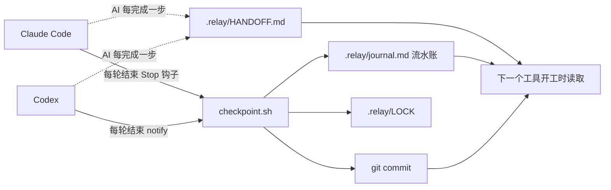

# relay：让 Claude Code、Codex、WorkBuddy 接力干同一个活

Claude Code 干到一半，5 小时额度用完了。换到 Codex，新会话能看到项目文件，却不知道哪一步已经定稿、哪段还在等核对、上一轮为什么放弃了某个方案。你只能从头再讲一遍，讲漏一条，它就可能把定好的东西改回去。

relay 把「做到哪了」写进项目目录。三个工具轮流上岗，谁接班都先读同一套文件，开口第一句先报告接力状态，然后接着干。

- 进度存在磁盘上，不存在任何一个工具的会话里
- 每轮结束由脚本自动写流水账、自动 git 提交，不调用模型，不花 token
- 新会话第一句先报告「上一棒是谁、做到哪、下一步做什么」，你核对一眼就能放手

## 效果

在 Codex 里只说一句「继续」，它的第一次回复长这样（根据作者一次真实接班整理）：

```
【接力状态】
- 上一棒：Claude Code，2026-11-12 17:27（约 10 分钟前）
- 已完成：第 33 篇的正文、5 张配图、排版、封面、服务号 8 张卡和配文都做完了
- 进行中：服务号配文已存盘，等待核对字数
- 下一步：读 33_.../服务号配文.md，核对正文字数
- 最近改动：.relay/HANDOFF.md、33_.../服务号配文.md
```

然后它读交接文件、翻最近 3 条流水账，接着上一棒停下的地方往下做。反过来从 Codex 切回 Claude Code 也一样。

作者在公众号写作项目里实测过 Claude Code 和 Codex 之间的双向接班和自动存档。WorkBuddy 没有结束钩子，靠 AGENTS.md 里的规则维护交接文件，不会自动存档。

## 原理



| 文件 | 谁写 | 内容 |
|---|---|---|
| `.relay/HANDOFF.md` | AI | 当前状态：目标、已完成、进行中（精确到下一步动作）、待办、本任务内的决定、坑。不超过 60 行，覆盖更新，不记历史 |
| `.relay/journal.md` | 脚本 | 每轮一条：时间、工具、用户说了什么、AI 最后回了什么、改了哪些文件。只留最近 30 条，更早的移到 `journal-archive.md` |
| `.relay/LOCK` | 脚本 | 最近在干活的工具和时间。10 分钟内另一个工具还在干活时，接班的先停下问你 |
| git 提交 | 脚本 | 每轮结束 `git add -A && git commit`，额度突然掐断，最多丢最后一轮还没写盘的内容 |

分工的考虑：HANDOFF 只有 AI 写得清楚「下一步做什么」，所以交给 AI；流水账和存档是机械活，交给脚本，不占额度。

Claude Code 的 `Stop` 钩子还多做一件事：这一轮改了文件，HANDOFF 却超过 15 分钟没更新，就拦住这一轮，让 AI 先补交接再结束。每轮最多拦一次。

## 前提条件

| 依赖 | 用途 |
|---|---|
| macOS 或 Linux，bash | 运行脚本 |
| git | 自动存档 |
| jq | 解析钩子传来的 JSON |
| Python 3.11+（需要 `tomllib`） | `doctor.sh` 读写 Codex 配置 |
| Claude Code / Codex / WorkBuddy | 至少装两个才有接力的意义 |

几个工具必须在**同一个项目目录**里干活。脚本从当前目录往上找 `.relay/`，找不到就什么都不做，所以没启用 relay 的目录不受影响。

## 安装

装进 Claude Code 或 Codex 中**任意一个**就行，其他工具在启用时自动补上。

```bash
git clone --depth 1 https://github.com/RockQ/fde-china-guide.git

# 装进 Claude Code
mkdir -p ~/.claude/skills && cp -R fde-china-guide/skills/relay ~/.claude/skills/relay

# 或者装进 Codex
mkdir -p ~/.codex/skills && cp -R fde-china-guide/skills/relay ~/.codex/skills/relay
```

也可以直接把仓库地址丢给 Claude Code 或 Codex，让它帮你装。

## 启用

### 方式一：让 Agent 自己配（推荐）

进入项目目录，在装了 relay 的那个工具里说：

> 启用接力

Agent 会按 SKILL.md 里「安装后启用」的步骤执行：检查依赖、初始化目录、把 relay 链接给本机装了的其他工具、增量配置两个工具的钩子（先备份，不覆盖已有配置）、跑体检，最后告诉你还差什么。配完要**重开会话**才生效。

### 方式二：手动配

下面的命令以装在 `~/.claude/skills/relay` 为例，装在别处就换成实际路径。

**1. 初始化项目目录**

```bash
bash ~/.claude/skills/relay/scripts/init.sh /path/to/your/project
```

它会：
- 建 `.relay/`，放入 HANDOFF 模板和空流水账
- 目录还不是 git 仓库时执行 `git init`，并提交一次
- 往 `.gitignore` 追加图片、视频、PDF、Office 文件等二进制的忽略规则（这些文件不会进自动存档）
- 往 `AGENTS.md` 追加接力协议，Codex 和 WorkBuddy 靠这段规则开工时报告状态
- 检查本机装了哪些工具（`~/.claude`、`~/.codex`、`~/.workbuddy`），缺 relay 的就链接过去
- 生成 `.relay/skills.txt` 和 `.relay/writable.txt`，最后跑一次体检

**2. 配置 Claude Code 钩子**

在 `~/.claude/settings.json` 的 `hooks` 里加入（已有其他钩子就并列追加）：

```json
{
  "hooks": {
    "SessionStart": [
      { "hooks": [ { "type": "command", "command": "bash ~/.claude/skills/relay/scripts/session_start.sh" } ] }
    ],
    "Stop": [
      { "hooks": [ { "type": "command", "command": "bash ~/.claude/skills/relay/scripts/claude_stop.sh" } ] }
    ]
  }
}
```

`SessionStart` 在新会话开始时把 HANDOFF、最近 3 条流水账和最近 5 次提交注入上下文；`Stop` 在每轮结束时存档。

**3. 配置 Codex notify**

在 `~/.codex/config.toml` 顶部加入（写绝对路径）：

```toml
notify = ["/Users/<你的用户名>/.claude/skills/relay/scripts/codex_notify.sh"]
```

Codex 只允许一个 `notify`。原来已经配了别的通知命令的，把原命令放进环境变量，`codex_notify.sh` 会先转发给它，再存档：

```bash
export RELAY_CODEX_NOTIFY_FORWARD="/path/to/your/old-notify"
```

没设这个变量时，脚本会尝试转发给 Codex Computer Use 自带的通知程序（存在才转发）。

**4. 体检**

```bash
bash ~/.claude/skills/relay/scripts/doctor.sh /path/to/your/project
```

检查 git、jq、两个工具的钩子、skill 对齐和 Codex 权限。加 `--fix` 自动修复 skill 对齐和 Codex 权限，见下文「可选配置」。

## 日常使用

额度用完，换另一个工具，进同一个目录，说「继续」。

就这一句。接班的工具会先报告接力状态，再接着干。你要做的只有核对状态报告对不对，不对就当场纠正。

干活过程中不需要你手动维护任何东西：AI 每完成一个步骤更新一次 HANDOFF，脚本每轮自动存档。

查看接力统计：

```bash
bash ~/.claude/skills/relay/scripts/status.sh
```

输出最近干活的工具、HANDOFF 大小、各工具轮次，以及更新交接大约花了多少 token（粗估）。

## 可选配置

**`.relay/skills.txt`**：本项目要用的 skill，每行一个。`doctor.sh --fix` 会把 `~/.claude/skills` 里对应的 skill 链接到 `~/.codex/skills` 和 `~/.workbuddy/skills`，保证换了工具，能用的 skill 还是同一套。

**`.relay/writable.txt`**：项目目录之外、Codex 需要写入的目录，每行一个。`doctor.sh --fix` 会把它们加进 Codex 的 `writable_roots`，同时打开 `network_access`，并信任当前项目目录。改之前自动备份 `config.toml`。

注意：Codex 的联网和可写目录是**全局设置**，打开后在所有目录都生效。纯本地接力用不到这两项，可以不配。想收回，删掉 `~/.codex/config.toml` 里的 `[sandbox_workspace_write]` 段即可。

## 边界和注意事项

- **两个工具不能同时干同一个目录。** relay 解决的是轮流接班，不处理并发修改。LOCK 只做提醒，不加锁。
- **只存已经写盘的东西。** 额度掐断时 AI 脑子里还没写进文件的内容，存档救不回来。所以规则要求 AI 每完成一步就更新 HANDOFF。
- **自动提交会提交整个目录。** 每轮执行 `git add -A`，项目里有不想进 git 的文件，先写进 `.gitignore`。自动存档只在本地提交，不会推送远端。
- **二进制默认不进存档。** `init.sh` 加的忽略规则会让图片、PDF 等文件不受 git 跟踪。需要跟踪的，自己从 `.gitignore` 里删掉对应行。
- **WorkBuddy 没有自动存档。** 它没有结束钩子，只靠 AGENTS.md 的规则开工报状态、更新 HANDOFF。它改的文件要等下一次 Claude Code 或 Codex 结束一轮时一起提交，流水账里也不会有 WorkBuddy 的记录。
- **Codex 的后台调用已过滤。** Codex 客户端生成推荐问题、起任务标题时也会触发 notify，脚本按这两类提示词的开头过滤掉。Codex 以后改了这些提示词，流水账里可能出现几条噪音记录，不影响接力。
- **配置改完要重开会话。** 钩子、skill 链接、Codex 权限都在会话启动时加载。

## 卸载

1. 从 `~/.claude/settings.json` 删掉两个 relay 钩子，从 `~/.codex/config.toml` 删掉 `notify` 行（有原通知命令的，改回原命令）
2. 删掉各工具 skills 目录下的 `relay`（安装的那份是目录，启用时补上的是链接）
3. 项目里的 `.relay/` 目录、`AGENTS.md` 里的「接力协议（relay）」一节可以留作记录，也可以删掉

## 文件结构

```
relay/
├── SKILL.md              # 给 AI 看的规则：接班、干活、启用步骤
├── README.md             # 本文件
├── templates/
│   └── HANDOFF.md        # 交接文件模板
└── scripts/
    ├── init.sh           # 在一个目录启用接力
    ├── doctor.sh         # 体检，--fix 自动修复
    ├── status.sh         # 接力统计
    ├── session_start.sh  # Claude Code SessionStart 钩子
    ├── claude_stop.sh    # Claude Code Stop 钩子
    ├── codex_notify.sh   # Codex notify 包装
    ├── checkpoint.sh     # 写流水账、更新 LOCK、git 提交
    └── lib.sh            # 公共函数
```

## 来源

这个 skill 来自公众号「AI办公前线」的写稿实践。在客户现场交付的 FDE 是一支团队，项目能在人和人之间接得住，靠的是交接文档写到下一个人能直接上手。relay 把同一套纪律用在了 AI 工具之间。

问题和改进欢迎提 Issue 或 PR。许可证同本仓库（CC BY 4.0）。
